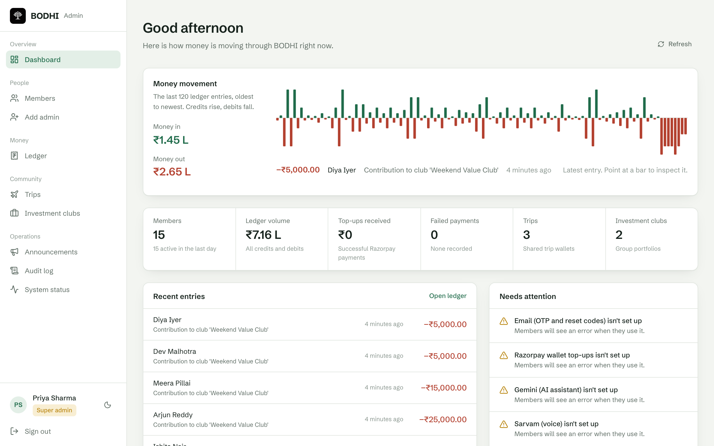

# BODHI Admin

The operations dashboard for BODHI. Staff use it to watch money moving through member wallets, look up and suspend members, review trips and investment clubs, send in-app announcements, and check that the backend and its integrations are set up.



## Pages

| Page | What it does |
| :--- | :--- |
| Dashboard | Money-movement chart of the last 120 ledger entries, key figures, recent entries and a "needs attention" list |
| Members | Search, filter by role, page through accounts; open a member to see wallet activity and paper trades, or suspend them |
| Ledger | Every credit and debit, filterable, with copyable references |
| Trips / Investment clubs | All shared trip wallets and group portfolios |
| Announcements | Send an in-app notification with a live phone preview |
| Audit log | Who did what, grouped by day (super admins only) |
| System status | Database latency and which integrations have keys configured |
| Add admin | Create a dashboard-only admin account |

Light and dark themes follow the operating system, with a toggle in the sidebar.

## Run it locally

```bash
npm install
NEXT_PUBLIC_API_URL=http://127.0.0.1:8000 npm run dev
```

`NEXT_PUBLIC_API_URL` is the backend's base URL (without `/admin-v2`). It defaults to the deployed API Gateway. The backend must allow the dashboard's origin in `ALLOWED_ORIGINS`.

Sign in with an account whose role is `super_admin`, `admin` or `support`. To make your first super admin, set `role = 'super_admin'` on a user row in the database; after that, new admins can be added from the **Add admin** page.

## Build

```bash
npm run build   # static export to ./out
```

The app is a static export (`output: 'export'`), so `./out` can be hosted on S3, CloudFront, Netlify or any static host. There is no Node server to run.

## Checks

```bash
npx eslint src
npx tsc --noEmit
```
